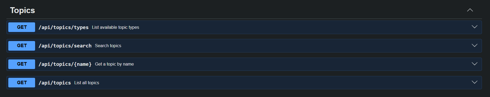
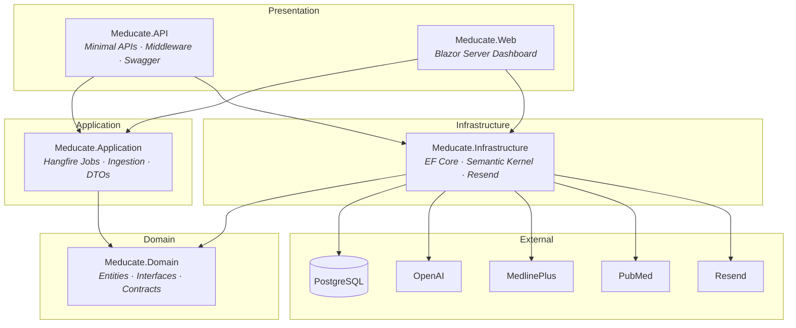
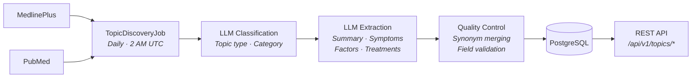

# MeducateAPI

**A medical education API that transforms raw health data into structured, searchable knowledge.**




## What It Does

MeducateAPI automatically discovers and aggregates medical topics from authoritative sources like MedlinePlus and PubMed, then uses LLM processing to extract structured data (summaries, symptoms, risk factors, and treatments), all classified into body-system and content-type categories. The result is a clean REST API that developers can use to build health education tools without wrangling raw medical data themselves.

## Live

- **Web Dashboard**: [meducateapi.com](https://meducateapi.com)
- **REST API**: [api.meducateapi.com](https://api.meducateapi.com)

## Key Features

- **Magic-link authentication**: passwordless email sign-in with cookie-based sessions
- **API key management**: create, rename, and revoke keys per organisation (max 5 active)
- **Rate limiting**: two-tier system: 60 req/min per key + configurable daily limits with 80% usage alerts
- **Automated topic discovery**: daily Hangfire jobs fetch new topics from MedlinePlus at 2 AM UTC
- **Automated topic refresh**: existing topics re-processed daily at 3 AM UTC for accuracy
- **Source grounding**: before a topic is saved, each list item is checked against the source text (a model judgement plus a word-overlap check, which must both say "unsupported") and removed if the source does not back it. It is a safety net, not a guarantee
- **No regressions on refresh**: a re-extraction that fails a quality check the stored topic passes, or empties a list the stored topic had, is discarded and the stored version stays live
- **Nightly drift detection**: a rotating batch of live topics is re-checked against their original source text each night; low keyword overlap flags likely hallucination or staleness, and structural failures (missing fields, invalid categories) trigger an email alert
- **Spend guard**: every LLM call is metered against a daily budget, so a bug or a retry loop cannot run up a bill
- **Topic classification**: LLM-powered categorisation into 26 standardised medical categories
- **ICD-11 coding**: diagnosable topics (Disease, Disorder, Syndrome, Symptom, Mental Health) are matched against the WHO ICD-11 API for a real, verifiable diagnostic code, not LLM-generated
- **OpenAPI spec and Postman collection**: full OpenAPI 3 document at `/swagger/v1/swagger.json`, plus a ready-made Postman collection with tests
- **Usage dashboard**: Blazor Server UI for managing keys, viewing usage, and browsing docs

## Architecture



The project follows **Clean Architecture** with four layers, each depending only inward:

| Layer | Project | Responsibility |
|---|---|---|
| **Domain** | `Meducate.Domain` | Entities, repository interfaces, service contracts, zero external dependencies |
| **Application** | `Meducate.Application` | Business logic, Hangfire jobs, ingestion/refresh orchestration, DTOs |
| **Infrastructure** | `Meducate.Infrastructure` | EF Core + PostgreSQL, Semantic Kernel + OpenAI, Resend email, API key hashing |
| **API / Web** | `Meducate.API` / `Meducate.Web` | Minimal API endpoints, middleware pipeline, Blazor Server dashboard |

## Tech Stack

| Category | Technology |
|---|---|
| Runtime | .NET 10, ASP.NET Core Minimal APIs |
| Frontend | Blazor Server |
| Database | PostgreSQL via EF Core (Npgsql) |
| AI / LLM | Microsoft Semantic Kernel + OpenAI (gpt-4o-mini, optional stronger model for topics that fail a quality check) |
| Background Jobs | Hangfire with PostgreSQL storage |
| Email | Resend API |
| Auth | Cookie-based with magic-link verification |
| API Docs | Swashbuckle (Swagger / OpenAPI) |
| Hosting | Railway |

## Data Pipeline



## API Endpoints

### Topics (requires API key)

| Method | Endpoint | Description |
|---|---|---|
| `GET` | `/api/v1/topics` | List all topics (paginated, filterable by type and category) |
| `GET` | `/api/v1/topics/search` | Search topics by name (same type and category filters) |
| `GET` | `/api/v1/topics/{name}` | Get a single topic by exact name |
| `GET` | `/api/v1/topics/icd11/{code}` | Get the topic carrying a WHO ICD-11 code |
| `GET` | `/api/v1/topics/types` | List available topic types, with counts |
| `GET` | `/api/v1/topics/categories` | List medical categories, with counts |
| `GET` | `/api/v1/topics/changes?since=` | Topics added or updated since a timestamp, newest first |

A [Postman collection](https://meducateapi.com/meducate-api.postman_collection.json) covers all of these with example parameters and tests (Postman: Import, paste the URL).

### Auth

| Method | Endpoint | Description |
|---|---|---|
| `POST` | `/api/v1/users/register` | Request a magic link |
| `POST` | `/api/v1/users/verify` | Verify token and start session |
| `POST` | `/api/v1/auth/logout` | Sign out |
| `GET` | `/api/v1/users/me` | Get current user info |
| `DELETE` | `/api/v1/users/me` | Delete account |

### Organisations & Keys

| Method | Endpoint | Description |
|---|---|---|
| `POST` | `/api/v1/orgs` | Create an organisation |
| `POST` | `/api/v1/orgs/{id}/keys` | Generate an API key |
| `GET` | `/api/v1/orgs/{id}/keys` | List API keys |
| `PATCH` | `/api/v1/orgs/{orgId}/keys/{keyId}` | Rename a key |
| `DELETE` | `/api/v1/orgs/{orgId}/keys/{keyId}` | Revoke a key |

### System

| Method | Endpoint | Description |
|---|---|---|
| `GET` | `/health` | Database health check |

## Sample Response

`GET /api/v1/topics/Type 2 Diabetes` (real response, lists shortened here)

```json
{
  "id": "a1000000-0000-0000-0000-000000000002",
  "name": "Type 2 Diabetes",
  "summary": "Type 2 diabetes is a chronic disease in which blood glucose levels are too high due to insufficient insulin production or ineffective use of insulin. It usually begins with insulin resistance, requiring more insulin for glucose to enter cells, and can develop slowly over time. Risk factors include being overweight or having obesity, not being physically active, genetics and family history, being over age 45, having prediabetes, a history of gestational diabetes, certain ethnic backgrounds, and having other health conditions such as high blood pressure. Symptoms may be absent or mild initially but can include increased thirst and urination, fatigue, blurred vision, and sores that do not heal. Treatment aims to manage blood glucose levels through a healthy lifestyle and, when necessary, medications.",
  "topicType": "Disease",
  "category": "Endocrine, Nutritional & Metabolic",
  "icd11Code": "5A11",
  "icd11Title": "Type 2 diabetes mellitus",
  "symptoms": [
    "High blood glucose levels",
    "Increased thirst and urination",
    "Fatigue",
    "Blurred vision"
  ],
  "causes": [
    "Being overweight or having obesity",
    "Not being physically active",
    "Genetics and family history",
    "Age over 45"
  ],
  "treatments": [
    "Following a healthy eating plan",
    "Getting regular physical activity",
    "Regular blood glucose monitoring",
    "Taking oral medications"
  ],
  "citations": [
    "National Institute of Diabetes and Digestive and Kidney Diseases"
  ],
  "tags": [
    "diabetes",
    "blood glucose",
    "insulin resistance",
    "symptoms",
    "risk factors"
  ],
  "lastUpdated": "2026-11-04T13:48:02.914747Z",
  "version": 12
}
```

> Response field names adapt to topic type: for example, a Symptom returns `relatedSymptoms`, `associatedConditions`, and `management` instead of `symptoms`, `causes`, and `treatments`.

## Data sources and attribution

Health information from MedlinePlus and PubMed, U.S. National Library of Medicine. ICD-11 codes and titles are © World Health Organization, used under the WHO ICD API terms of use. The topic text is rewritten and restructured from those sources by a language model, not copied; some phrases still follow the source wording closely (see each topic's `citations`). It has not been clinically reviewed. **This is not medical advice**: use it for education and information only, never for diagnosis or treatment decisions, and go to the cited source for anything that matters.

About 870 topics are served, which is MedlinePlus's health-topic list (conditions, symptoms, procedures, tests) rather than all of MedlinePlus; individual drugs are only partly covered. A few overview topics (for example Anatomy) have empty lists because their source has no symptoms, risk factors or treatments to extract.

## License

The code in this repository is released under the [MIT License](LICENSE). That covers the code only. The health content it serves comes from MedlinePlus and PubMed (U.S. National Library of Medicine), and the ICD-11 codes and titles belong to the World Health Organization; both stay subject to their own terms (see the attribution above).

## Design Decisions

**Semantic Kernel** was chosen over direct OpenAI SDK calls because it provides a clean abstraction for prompt orchestration and makes it straightforward to swap models or add prompt filters without touching business logic. **Hangfire** handles the daily discovery and refresh pipeline: its PostgreSQL-backed persistence means jobs survive restarts, and the built-in dashboard makes it easy to monitor and retry failures. **Magic-link auth** eliminates password management entirely, which is appropriate for a developer-facing tool where security matters but registration friction should be minimal. The overall **Clean Architecture** keeps the domain free of infrastructure concerns, so the data providers, LLM processor, and persistence layer can all be replaced independently, which is useful when external APIs change or better models become available.

## Roadmap

**Data scope**
- Deeper drug coverage (individual drugs are only partly covered today)
- Cross-reference multiple sources per topic (MedlinePlus + PubMed + WHO)

**API features**
- Webhooks for topic update notifications
- SDKs / client libraries

**Infrastructure**
- Observability dashboards / APM (structured JSON logging in production already ships, and this is the next layer on top)
